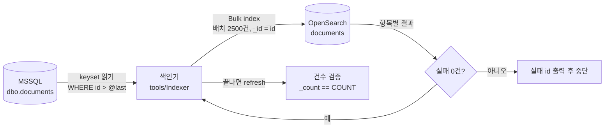

# korean-search-api

ASP.NET Core(.NET 10)와 MSSQL로 만드는 한국어 검색 API입니다.

## 로컬 실행

1. `db/init.sql`을 MSSQL에 실행합니다.
2. 연결 문자열을 user secrets에 넣습니다. (비밀번호는 커밋하지 않습니다.)

   ```bash
   dotnet user-secrets set "ConnectionStrings:Search" "<연결 문자열>" --project src/SearchApi
   ```

3. OpenSearch(Nori 플러그인 포함)를 빌드하고 실행합니다. (개발 전용으로 보안 플러그인을 끈 상태입니다.)

   ```bash
   docker build -t korean-search-opensearch:3.9.0 opensearch
   docker run -d --name opensearch -p 9200:9200 -e discovery.type=single-node -e DISABLE_SECURITY_PLUGIN=true -e DISABLE_INSTALL_DEMO_CONFIG=true korean-search-opensearch:3.9.0
   ```

   볼륨을 쓰지 않으므로 `docker rm opensearch`로 컨테이너를 지우면 인덱스도 사라집니다. 이 경우 4~5단계로 다시 만듭니다(색인 약 26초).

4. 인덱스를 만듭니다. `PUT /documents`에 `opensearch/documents-index.json`을 보냅니다.

   ```bash
   curl -X PUT "localhost:9200/documents" -H "Content-Type: application/json" --data-binary "@opensearch/documents-index.json"
   ```

5. 데이터를 적재하고 색인합니다. 두 도구 모두 환경 변수 `SEARCH_CONN`(MSSQL 연결 문자열)을 읽습니다.

   ```bash
   dotnet run --project tools/Loader    # Wikipedia 1만 건 → MSSQL dbo.documents
   dotnet run --project tools/Indexer   # MSSQL → OpenSearch documents
   ```

6. API를 실행합니다.

   ```bash
   dotnet run --project src/SearchApi
   ```

## 데이터 출처

- Wikipedia 한국어: Hugging Face `wikimedia/wikipedia` 데이터셋 `20231101.ko` 앞 1만 건. 라이선스 CC BY-SA.
- Loader가 내려받은 원본은 `data/`에 캐시되며, `data/`는 커밋하지 않습니다(`.gitignore`).

## 구성

MSSQL(원본) → 색인기(콘솔) → OpenSearch(Nori 분석기) ← 검색 API

## 색인 흐름



- 분석기: `nori_tokenizer`(decompound_mode `mixed`) + `nori_part_of_speech` + `nori_readingform` + `lowercase`
- 매핑: `dynamic: strict`. 필드 이름 오타가 조용히 새 매핑을 만들지 않게 하려고.
- 색인기를 콘솔로 둔 이유: 실무 환경과 유사하게 세팅.

## 측정 (로컬 Docker, 1회)

| 항목 | 값 |
|---|---|
| 문서 수 (MSSQL / OpenSearch) | 10012 / 10012 |
| 배치 크기 × 배치 수 | 2500 x 5 |
| 색인 소요 시간 | 26.543초 |
| 재색인 후 문서 수 | 10012 (같은 `_id` 덮어쓰기) |

## 검색

`GET /api/search?q=...&page=1&size=10`: body `match`, 점수순(BM25). 상태 코드: q 누락 400, 공백·범위 밖 422, OpenSearch 연결 실패 503, OpenSearch 오류 응답 502.
