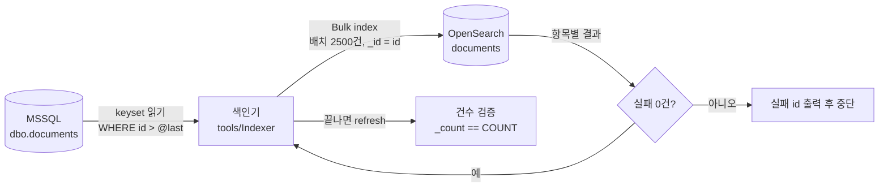
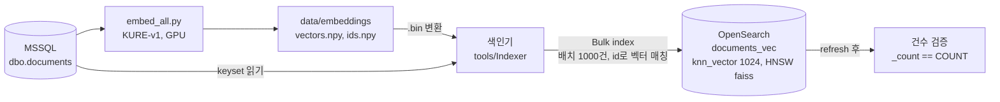
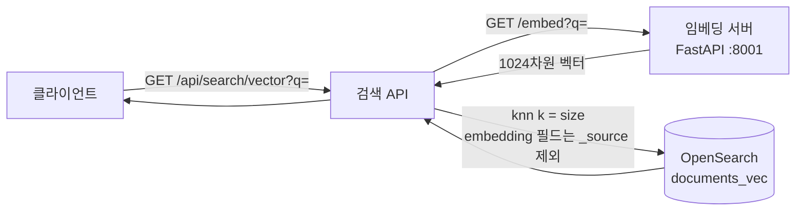

# korean-search-api

ASP.NET Core(.NET 10)와 MSSQL로 만드는 한국어 검색 API입니다. BM25(Nori) 검색과 임베딩 기반 벡터 검색(k-NN)을 제공합니다.

## 로컬 실행

1. `db/init.sql`을 MSSQL에 실행합니다.
2. 연결 문자열을 user secrets에 넣습니다. (비밀번호는 커밋하지 않습니다.)

   ```bash
   dotnet user-secrets set "ConnectionStrings:Search" "<연결 문자열>" --project src/SearchApi
   ```

3. OpenSearch(Nori 플러그인 포함)를 빌드하고 실행합니다. (개발 전용으로 보안 플러그인을 끈 상태입니다.)

   ```bash
   docker build -t korean-search-opensearch:3.9.0 opensearch
   docker run -d --name opensearch -p 9200:9200 -e discovery.type=single-node -e DISABLE_SECURITY_PLUGIN=true -e DISABLE_INSTALL_DEMO_CONFIG=true korean-search-opensearch:3.9.0
   ```

   볼륨을 쓰지 않으므로 `docker rm opensearch`로 컨테이너를 지우면 인덱스도 사라집니다. 이 경우 4~5단계로 다시 만듭니다.

4. 인덱스를 만듭니다.

   ```bash
   curl -X PUT "localhost:9200/documents" -H "Content-Type: application/json" --data-binary "@opensearch/documents-index.json"
   curl -X PUT "localhost:9200/documents_vec" -H "Content-Type: application/json" --data-binary "@opensearch/documents_vec-index.json"
   ```

5. 데이터를 적재하고 색인합니다. 모든 도구는 환경 변수 `SEARCH_CONN`(MSSQL 연결 문자열)을 읽으며, 저장소 루트에서 실행합니다.

   ```bash
   dotnet run --project tools/Loader                          # Wikipedia 1만 건 → MSSQL dbo.documents
   python tools/embed/embed_all.py --max-seq 4096 --batch 8   # MSSQL → data/embeddings/vectors.npy, ids.npy
   python -c "import numpy as np; np.load('data/embeddings/vectors.npy').tofile('data/embeddings/vectors.bin'); np.load('data/embeddings/ids.npy').tofile('data/embeddings/ids.bin')"
   dotnet run --project tools/Indexer                         # MSSQL + data/embeddings/*.bin → OpenSearch documents_vec
   ```

   - `embed_all.py`에는 `torch`, `sentence-transformers`, `numpy`, `pyodbc`가 필요합니다. GPU가 있으면 CUDA로 실행합니다.
   - Indexer는 헤더 없는 `.bin`(float32 [문서 수 × 1024], int64 id)을 읽으므로 세 번째 줄로 `.npy`를 변환합니다.
   - 현재 Indexer는 `documents_vec`만 색인합니다. BM25용 `documents` 인덱스는 커밋 `ff8cb77`의 Indexer로 만듭니다.

6. 질의 임베딩 서버를 실행합니다(포트 8001). API는 설정 `Embed:Url`(기본값 `http://127.0.0.1:8001`)로 이 서버를 호출합니다.

   ```bash
   cd tools/embed
   uvicorn server:app --port 8001
   ```

7. API를 실행합니다.

   ```bash
   dotnet run --project src/SearchApi
   ```

## 데이터 출처

- Wikipedia 한국어: Hugging Face `wikimedia/wikipedia` 데이터셋 `20231101.ko` 앞 1만 건. 라이선스 CC BY-SA.
- 저장소에 포함하지 않는 것(`data/`, `.gitignore`):
  - Loader가 내려받은 위키 원본 캐시
  - 임베딩 파일 `data/embeddings/` (`vectors.npy` 약 41MB, `ids.npy`, 변환한 `.bin`)
- 둘 다 위 5단계로 다시 만들 수 있습니다.

## 임베딩 모델

- `nlpai-lab/KURE-v1` (https://huggingface.co/nlpai-lab/KURE-v1), 라이선스 MIT
- 출력 1024차원. 모델 파이프라인이 Transformer → Pooling(CLS) → Normalize라서 출력 벡터의 노름이 1입니다. 그래서 인덱스는 `space_type: innerproduct`를 쓰고, 내적이 곧 코사인 유사도입니다.
- 문서와 질의 모두 같은 모델, 같은 `max_seq_length`(4096)로 임베딩합니다.
- 정규화가 파이프라인에 없는 모델로 바꾸면 문서·질의를 직접 정규화하거나 `cosinesimil`을 쓰고, 어느 쪽이든 전체를 다시 색인해야 합니다.

## 구성

MSSQL(원본) → 색인기(콘솔) → OpenSearch(Nori 분석기, k-NN) ← 검색 API → 임베딩 서버(FastAPI)

## 색인 흐름

### BM25 (`documents`)



- 분석기: `nori_tokenizer`(decompound_mode `mixed`) + `nori_part_of_speech` + `nori_readingform` + `lowercase`
- 매핑: `dynamic: strict`. 필드 이름 오타가 조용히 새 매핑을 만들지 않게 하려고.
- 색인기를 콘솔로 둔 이유: 실무 환경과 유사하게 세팅.

### 벡터 (`documents_vec`)



- 색인기는 MSSQL id로 `ids.bin`에서 행 번호를 찾아 그 행의 벡터를 붙입니다. 정렬 순서가 달라도 맞는 벡터를 찾고, 벡터 수와 id 수, id 수와 MSSQL 문서 수가 다르면 시작하지 않습니다.
- `documents_vec`는 `documents`와 같은 분석기·매핑에 `embedding` 필드(`knn_vector`, 1024, `innerproduct`, HNSW/faiss)를 더한 인덱스입니다.

### 질의 흐름 (`/api/search/vector`)



## 측정

| 항목 | 값 | 조건 |
|---|---|---|
| BM25 색인 (`documents`) | 26.543초 | 10012건, 배치 2500 × 5, 로컬 Docker, 1회 |
| 재색인 후 문서 수 | 10012 | 같은 `_id` 덮어쓰기 |
| 문서 임베딩 | 1294초(약 20분) | RTX 4060 Ti 8GB(cuda:0), 10012건, max_seq 4096, batch 8, 1회 |
| 벡터 색인 (`documents_vec`) | 34.396초 | 10012건, 배치 1000, 로컬 Docker, 1회. 문서 수 MSSQL과 일치 |
| 질의 1건: 임베딩 / 검색 | 16–21ms / 12–13ms | 연속 요청 |
| 질의 1건: 임베딩 | 90–240ms | 몇 초 간격을 둔 요청(유휴 후 느려짐, 원인 미확정) |
| 질의 1건: 첫 요청 | 2263ms / 284ms | 서버 기동 후 첫 요청 |

## 검색

- `GET /api/search?q=...&page=1&size=10`: body `match`, 점수순(BM25).
  상태 코드: q 누락 400, 공백·범위 밖 422, OpenSearch 연결 실패 503, OpenSearch 오류 응답 502.
- `GET /api/search/vector?q=...&size=10`: 질의를 임베딩해 `documents_vec`에 k-NN(k = size). 점수는 OpenSearch `innerproduct` 점수(내적 ≥ 0이면 1 + 내적).
  상태 코드: q 누락 400, 공백·size 1~50 밖 422, 임베딩 서버·OpenSearch 연결 실패 503, 둘 중 하나의 오류 응답 502.

### BM25와 벡터 비교에서 확인한 것 (size=3, 육안)

- k-NN은 관련 문서가 없어도 항상 k건을 돌려줍니다. 코퍼스에 없는 `가곡역`에 BM25는 0건, 벡터는 화곡역·역곡역·중곡역을 돌려줬습니다. "결과 없음"을 판단하려면 점수 하한이나 BM25 결합이 필요합니다.
- 짧은 질의와 약어는 의미보다 글자 모양에 끌립니다(`AGI` → SGI, AG, AI).
- 벡터는 문서 전체가 주로 다루는 내용과의 거리로 찾습니다. `무질서도`로는 엔트로피 문서를 찾지 못했지만(본문에 1회 등장), 문서가 스스로 쓰는 표현(`일로 변환할 수 없는 에너지를 나타내는 상태 함수`)으로는 2위였습니다.
